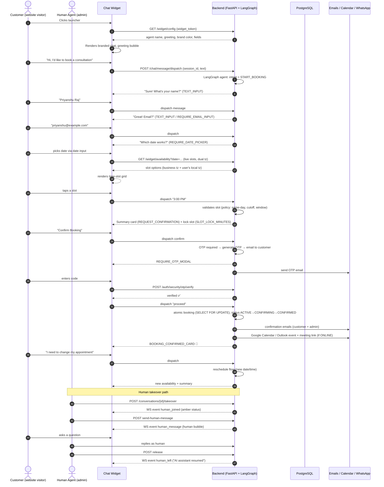

# DotStark AI Booking Agent — Complete Product Document

> **Source of truth:** Analysis of the actual codebase (backend FastAPI engine, chat widget, admin portal). Every feature listed below exists in code unless explicitly marked as partial or missing. Super Admin functionality is excluded.

---

## 1. Product Overview

**DotStark AI Booking Agent** is an enterprise-grade, multi-tenant conversational booking platform. Instead of making customers fill out forms or pick from a calendar on a separate page, the platform lets them complete a full booking by simply chatting — on your website (via an embeddable widget) or on WhatsApp — in natural language.

The AI agent (built on LangGraph) drives the entire conversation:

- **Collects booking details** (name, email, phone, custom business fields) by talking to the customer — not by form filling.
- **Shows real-time availability** with a date picker and live time-slot grid inside the chat, computed against your business schedule, exceptions, booking window, and timezone policy.
- **Verifies identity** with an OTP sent to the customer's email before finalizing (configurable).
- **Locks slots during the confirmation step** so two customers can never double-book the same time.
- **Creates the booking atomically** (SELECT FOR UPDATE), records a dual timezone snapshot (customer's timezone + business timezone), generates meeting links when needed (Google Meet / Microsoft Teams / Zoom), writes events to Google Calendar or Outlook Calendar, and emails confirmations to the customer and the business owner.
- **Handles post-booking requests in chat** — rescheduling, cancellation, rebooking, and general questions answered from the business knowledge base.
- **Hands off to a human agent** when needed — live takeover from the admin Inbox, with the customer seeing the human join in real time.

Behind the widget is a full admin portal: a Next.js dashboard where a business configures its agent persona, booking fields, business hours, exceptions, integrations (WhatsApp, calendar, meeting providers), uploads PDFs / crawls its website to train the agent's knowledge, monitors bookings, and manages customer conversations.

**Positioning:** "Enterprise-grade conversational AI booking platform. Enable your customers to book appointments via natural conversation."

**Stack:** FastAPI (Python 3.11) backend with async SQLAlchemy + PostgreSQL, LangGraph AI agent, vanilla-JS Shadow DOM chat widget (zero dependencies), Next.js admin panel, WhatsApp Cloud API integration, Firecrawl-powered website crawling, BM25 (PostgreSQL tsvector) retrieval for knowledge answers.

---

## 2. Target Audience

| Segment | Why they need it |
|---|---|
| **Clinics & healthcare** (dental, physio, dermatology, general practice) | 24/7 appointment booking, OTP-verified patient details, no missed calls |
| **Beauty & wellness** (salons, spas, barbers, nail studios) | Fast natural-language booking; staff can focus on clients, not phone calls |
| **Professional services** (lawyers, accountants, tax consultants, financial advisors) | Qualified lead capture (name/email/phone/OTP), consult scheduling, human handoff for complex cases |
| **Education & tutoring** (coaches, tutors, training institutes, language schools) | Students book sessions in chat; knowledge base answers curriculum/FAQ questions |
| **Agencies & consultancies** (marketing, design, dev, media buying) | Client intake via chat; meeting links auto-generated for online calls |
| **Real estate** (agents, property viewings) | Schedule viewings 24/7; capture buyer contact details with verification |
| **Fitness & personal training** (gyms, PTs, yoga studios, pilates) | Class/session slots, same-day policies, cancellation & reschedule in chat |
| **Home & field services** (HVAC, plumbing, electricians, cleaning, pest control) | After-hours bookings without staffing a phone line |
| **Automotive** (service centers, detailing, inspections) | Service appointment slots with custom fields (vehicle model, service type) |
| **Hospitals & diagnostic labs** | Test/consult slots with OTP verification of patient email |
| **Travel & hospitality** (travel agencies, boutique hotels, tours) | Tour/experience bookings and customer questions answered |
| **Recruitment & HR firms** | Interview scheduling with candidate contact verification |
| **Photography & creative services** (photographers, videographers, event planners) | Shoot bookings, pricing FAQ via knowledge base |
| **Churches, community & membership orgs** | Event/meeting scheduling with custom fields |
| **E-commerce & D2C brands with service teams** | Support chat that converts into booked calls/appointments |
| **SaaS platforms & agencies embedding on client sites** | Multi-tenant embed per client (widget token per org) — the platform's natural fit as white-label infrastructure |

**Buyer personas:** practice/business owners and office managers (admin portal users), plus developers/agencies who embed the widget and manage tokens (integration page with embed snippet).

---

## 3. Chat Widget Overview

The widget is a **zero-dependency vanilla JavaScript web component** built on Shadow DOM (custom element `dotstark-booking-widget`). It ships as a single script file and is embedded with one script tag:

```html
<script src="https://your-domain/static/widget/widget.js"
        data-widget-token="ds_wid_xxx"
        data-api-base="https://your-domain/api/v1"
        data-color="#FF6B00" defer></script>
```

A legacy `data-api-key` mode is still supported for backward compatibility, as is a programmatic `window.DotStarkBookingConfig` object.

Key design points:

- **No framework, no build deps** — plain JS appended to `<body>`; all styles are scoped inside the Shadow DOM, so the widget cannot be broken by (and cannot break) the host site's CSS.
- **Branded & themable** — brand color is applied from agent config (admin sets `ui_brand_color`) or `data-color`; agent name and greeting message come from the live `/widget/config` endpoint.
- **Conversational UI inside chat** — the AI sends *directives* (machine-readable instructions) alongside its reply; the widget renders the matching rich component: date picker, time-slot grid, phone input with country selector, option buttons, textarea/number/email inputs, OTP modal, booking summary card, and confirmed card.
- **Real-time via WebSocket** (`/ws/widget`) with human-agent events (`human_joined`, `human_left`, `human_message`), and a **polling fallback** (slow 30s cadence when WS is connected; fast 3s when a human is active and WS is down).
- **Session resumption** — session id persisted in `sessionStorage` (keyed per widget token + API base), history restored on refresh via `/widget/history` with incremental `since` fetching.
- **Timezone-aware** — browser timezone auto-detected and passed to the server; slot labels show both the business time and the user's local time; user can override timezone in the slot picker; fallback notice shown when the business timezone is used.
- **Mobile-first** — full-screen takeover on phones with safe-area insets, 16px inputs to prevent iOS zoom, and touch-sized targets.
- **Accessible** — ARIA roles on the dialog, live regions for screen readers, keyboard (Enter/Escape) support, focus management.

---

## 4. Complete Chat Widget Features (Evidence-Based)

| # | Feature | What it does | Code evidence |
|---|---|---|---|
| 1 | One-tag embed | `<script>` with `data-widget-token`, `data-api-base`, `data-color`; auto-creates and appends the widget element | `index.js` lines 1–55, 2901–2905 |
| 2 | Legacy `data-api-key` embed | Fallback config parsing for old embeds | `_readScriptAttrs()` |
| 3 | Programmatic config | `window.DotStarkBookingConfig = { widgetToken, apiBase, primaryColor }` | `CONFIG` resolution |
| 4 | Shadow DOM isolation | All markup/styles scoped; host-site CSS cannot leak in | `attachShadow({mode:"open"})` |
| 5 | Live agent config | Fetches `/widget/config` → agent name, greeting, brand color, fields | `_fetchAgentConfig()` |
| 6 | Brand color theming | CSS variables driven by config/`data-color` | `_buildShell()` |
| 7 | Custom greeting | Greeting message from config, fallback default | `_buildShell()` |
| 8 | Launcher button | Animated launcher w/ ripple, chat/close icon morph, hover/active states | CSS `.widget-launcher` |
| 9 | Open/close animations | Container scale/slide animations, mobile slide-up | `containerIn/Out`, `mobileSlideIn/Out` |
| 10 | Header with status | Agent name, live status dot ("Online — Ready to help" green; amber with human agent name) | `_updateHumanStatus` |
| 11 | Message bubbles | Agent/user/system bubbles, timestamps, hover effects, markdown (**bold**, *italic*, bullets) | `_appendBubble`, `_renderMarkdown` |
| 12 | Typing indicator | Animated dots while awaiting the AI reply | `_appendTyping` |
| 13 | Session persistence | sessionStorage keyed by token+base; auto-restore on reload | `_sessionStorageKey`, `_loadHistory` |
| 14 | History restore | `/widget/history` incremental fetch (`since` param) | `_loadHistory` |
| 15 | WebSocket real-time | `/ws/widget`; events: connected, human_joined, human_left, human_message, customer_message | `_connectWebSocket` |
| 16 | WS auto-reconnect | Exponential backoff capped at 30s | `ws.onclose` |
| 17 | Polling fallback | 30s (WS on) / 10s (default) / 3s (human active, WS down) | `_startPolling` |
| 18 | Message de-duplication | Rendered-id Set prevents double bubbles when WS + poll overlap | `_renderedMessageIds` |
| 19 | Human takeover UX | System notice "joined the chat", amber status, distinct human bubble w/ admin name | `_handleWsEvent`, `_appendHumanBubble` |
| 20 | Timezone detection | Browser tz auto-detect + persistence | `_detectBrowserTimezone` |
| 21 | Timezone override | Select in slot picker; "Your time: X" labels on slots | `_buildTimezoneContextBanner` |
| 22 | Date picker card | Native date input, min = today (in user tz), Confirm Date button | `_appendDatePicker` |
| 23 | Live availability fetch | `/widget/availability?date=…` → slots w/ user-tz + org-tz labels, availability status | `_fetchAvailabilityOptions` |
| 24 | Time-slot grid | Pill buttons per slot, dual-time labels, disabled for unavailable, error retry on taken slot | `_appendTimeSlotGrid` |
| 25 | No-slot fallback | Auto-fallback to date picker with contextual message (e.g., same-day disabled) | `_appendTimeSlotGrid` fallback |
| 26 | Phone input card | Country select (US/GB/IN/AU/CA) + local number, normalized E.164-ish send | `_appendPhoneInput` |
| 27 | Select option grid | Button grid for `select` fields, skip for optional | `_appendSelectInput` |
| 28 | Text/number/textarea/email inputs | Input-mode switching per field type w/ placeholders | `_updateInputMode` |
| 29 | Skip support | "Skip" button rendered for optional fields (`required:false`) | `_renderSkipAction` |
| 30 | Inline validation | Server validation errors shown inline in cards | `field-inline-error` |
| 31 | OTP modal | Verify code, resend w/ 30s cooldown + cap 3, "use different email" recovery | `_appendOTPInterface` |
| 32 | OTP status UX | "Resend available in Xs • N resends left", success message, error states (429 etc.) | OTP policy UI |
| 33 | Booking summary card | "📋 Booking Summary" with details, Confirm Booking / ✎ Change Details buttons | `_appendSummaryCard` |
| 34 | Confirmed card | 🎉 "Booking Confirmed!", email-on-its-way footer, "Start New Booking" button | `_appendConfirmedCard` |
| 35 | New session reset | Clears state/storage and restarts flow | `_startNewSession` |
| 36 | Typing/validation disable | Input disabled during OTP; re-enabled after verify | OTP logic |
| 37 | System messages | Channel status changes rendered as centered system bubbles | `_appendSystem` |
| 38 | Screen-reader announcements | `aria-live` polite region for new messages | `_announceToSR` |
| 39 | ARIA semantics | dialog, log, role=alert on confirmed card, labels | `_buildShell` |
| 40 | Keyboard support | Enter to send, Escape to close, launcher focusable | `_buildShell` events |
| 41 | Responsive mobile | Full-screen bottom-sheet on ≤480px, safe-area insets | CSS `@media (max-width:480px)` |
| 42 | iOS-friendly input | 16px font to avoid zoom-on-focus | CSS mobile rules |
| 43 | Powered-by footer | "Powered by DotStark AI" | `_buildShell` |
| 44 | Force new session | `forceNewSession` flag clears saved session | `connectedCallback` |
| 45 | Markdown-lite rendering | Bold, italic, bullets, emoji via safe DOM parsing (no innerHTML injection) | `_renderMarkdown`, `_parseInline` |

---

## 5. Admin Portal Overview

The admin portal is a **Next.js (App Router) application** with a dark, shadcn/ui-style design system, sidebar navigation, and breadcrumbs. It is the operational cockpit for a business running the booking agent.

- **Auth:** register (creates org + user), login, logout; JWT delivered as an HttpOnly cookie (`ds_token`, Secure, SameSite=None) with Bearer fallback; rate limited (register 5/min, login 10/min); failed logins are audit-logged.
- **Layout:** sidebar groups — **App**: Dashboard, Calendar, Inbox (Conversations); **Settings**: Agent Personalisation, Business Hours, Integration. Breadcrumbs in the dashboard layout.
- **Onboarding:** a checklist (configure agent → define fields → business hours → first booking) guides first-time users.
- **Dependency health:** the dashboard verifies database, LLM, and email readiness with retry.

---

## 6. Admin Features (Evidence-Based)

### 6.1 Dashboard (`/dashboard`)
- Stat cards: **Total Bookings, Confirmed, Active Conversations, Bookings This Week**.
- **Recent bookings** (10 latest) with customer/date/time/status.
- **Onboarding status** widget (4 steps, each linking to the right page).
- **Dependency health** card (database / LLM / email) with retry button.
- Backend: `GET /dashboard/stats`, `/recent-bookings`, `/dependency-health`, `/onboarding-status`.

### 6.2 Calendar (`/dashboard/calendar`)
- **Month grid** + **Agenda view** tabs.
- Clicking a day opens a **BookingDialog** showing the day's bookings; each booking shows customer name, email, phone, collected custom data, status.
- **Cancel booking** with reason (POST `/dashboard/bookings/{id}/cancel`).
- Backend also exposes `GET /dashboard/calendar-events` and `/upcoming-bookings`.

### 6.3 Inbox / Conversations (`/dashboard/conversations`)
- Conversation list with **status badges** (CONFIRMED green, ACTIVE/CONFIRMING yellow, CANCELLED red) and **channel badges** (WhatsApp green, Web blue); relative timestamps.
- **Transcript viewer** — full message history per session (`GET /dashboard/conversations/{id}/messages`).
- **Human takeover** — take over an AI conversation, reply as a human, then release back to AI (POST `/organizations/{org}/conversations/{id}/takeover`, `/release`, `/send-human-message`). Customer sees the takeover live via WebSocket.

### 6.4 Agent Personalisation (`/dashboard/agent`)
- **Agent identity:** agent name, greeting message, business name.
- **Persona tone:** professional / friendly / casual / formal / empathetic (persona-based custom prompts).
- **Booking fields editor:** define the exact fields the agent collects — types: text, email, phone, date, time, select (with options), number, textarea; each with label, icon, placeholder, required/optional toggle; validation on save (unique keys, label required).
- **Brand color** picker (`ui_brand_color`).
- **OTP toggle:** require email OTP before booking confirmation (default on).
- **Custom prompts:** advanced prompt overrides (including `allow_optional_contact_fields`).
- **Knowledge base** (see 6.7).

### 6.5 Business Hours (`/dashboard/business-hours`)
- **Weekly schedule:** per-day enabled/disabled, open time, close time, optional break (start/end).
- **Slot duration:** 15/30/45/60/90/120 minutes (default 60).
- **Booking window:** how many days ahead customers can book (default 60).
- **Timezone:** org timezone selector (UTC, America/*, Europe/*, Asia/Kolkata, Asia/Dubai, Asia/Singapore, Asia/Tokyo, Australia/Sydney …).
- **Exceptions:** per-date CLOSED or CUSTOM_HOURS overrides with reason; list/delete.
- **Slot preview:** live preview of generated slots for a chosen date (GET `/dashboard/schedule/preview`).

### 6.6 Integrations (`/dashboard/integrations`)
- **Meeting providers:** connect/disconnect **Google Meet, Microsoft Teams, Zoom**; set the active provider for auto-generating meeting links (OAuth flows; Zoom has its own callback route).
- **Calendar sync:** connect/disconnect **Google Calendar** and **Outlook Calendar** (single active calendar provider); booking events are written there on confirmation; connection state shown (success/error toast, error-code mapping for common OAuth failures).
- **WhatsApp Business:** connect a dedicated business number by scanning a QR code (Linked Devices); connection health, disconnect and reconnect from the same card. Unofficial WhatsApp Web transport — Meta may throttle or restrict automated numbers.
- **Widget token:** view / regenerate / delete the `ds_wid_*` token; embed code is shown in **Production** and **Dev** tabs (dev API base defaults to `http://localhost:5174`); API base stored under `dotstark_public_api_base` for preview.

### 6.7 Knowledge Base (under Agent Personalisation)
- **PDF upload:** up to 10 PDFs per org, 25 MB each, PDF-only, duplicate-content rejection (content hash); pages reported; chunks extracted and stored.
- **Website crawl:** start a crawl of a URL via Firecrawl; status (queued/in-progress/completed/failed), pages crawled; **webhook** (`/api/v1/firecrawl/webhook`) receives progress; chunks stored with source URL.
- **List / delete:** docs and website sources manageable; crawling is deletable.
- **Usage:** retrieval is injected into the agent's context (see Technical Highlights) — the agent answers business questions from these documents, filtered by business name.

### 6.8 Platform-level capabilities backing the above
- **Audit log** of auth + booking events (backend).
- **System alerts** for operational failures (e.g., meeting-link provider down) — backend endpoints exist.
- **Rate limiting** on public endpoints (slowapi), **CSRF protection**, correlation IDs for tracing.

---

## 7. End-to-End User Journey (with Mermaid)



**Flow summary (text):** Customer opens widget → AI greets → collects details conversationally → date picker → live time slots (in customer's timezone) → summary + confirm → email OTP verification → booking confirmed atomically → confirmation emails, calendar event, meeting link → customer can reschedule/cancel in chat → human agent can take over live from the Inbox at any point.

---

## 8. Key Benefits

1. **Bookings 24/7 without a phone line** — the agent never sleeps, never misses a call, never puts anyone on hold.
2. **Conversational, not form-based** — customers type naturally; the AI extracts, validates, and confirms data (dates like "next Tuesday" are parsed and validated).
3. **Real-time availability, zero double-booking** — slots are computed on demand from the live schedule and locked during confirmation; booking commit is atomic with row-level locking.
4. **Anti-fraud / quality leads** — OTP email verification before confirming means fake and mistyped contacts get filtered out; every field is validated server-side.
5. **Multi-channel** — one agent powers the website widget **and** WhatsApp (Meta Cloud API), with the same engine, session logic, and admin visibility.
6. **Automatic ops** — confirmation emails (customer + admin), calendar events (Google/Outlook), and auto-generated meeting links (Meet/Teams/Zoom) are created from the chat itself.
7. **Human handoff when it matters** — live takeover, human bubbles, and release back to AI; conversations never need to restart.
8. **Knowledge-backed answers** — PDFs and website content are crawled and chunked; the agent answers business FAQs in chat from your own documents (BM25 retrieval + rerank).
9. **Timezone intelligence** — customers see slots in their own timezone; the business sees (and email confirmations show) both; fallbacks are explicit, not silent.
10. **Fully brandable, zero-friction embed** — one script tag, brand color, custom agent name/greeting/persona.
11. **Complete admin control** — fields, hours, exceptions, durations, windows, OTP policy, providers, tokens — no code needed.
12. **Enterprise hygiene** — per-org widget tokens (not API keys) in embeds, rate limiting, CSRF protection, audit logging, secure HttpOnly auth cookies.
13. **Self-service reschedule/cancel** — customers fix their own bookings in chat, cutting no-show and admin workload.
14. **Resilient UX** — WebSocket with polling fallback, session resumption, message de-duplication; bookings survive network hiccups.
15. **Multitenant-ready** — org-scoped tokens, configs, documents, and data isolation throughout.

---

## 9. Real Business Use Cases (15+)

1. **Dental clinic** — patients book hygiene visits/consults 24/7; OTP verifies their email; reminder-ready records for staff.
2. **Physiotherapy practice** — 30/45/60-min session slots with break-aware scheduling; patients reschedule in chat when they're running late.
3. **Salon & spa** — customers pick stylist service slots with custom fields (service type, preferred stylist); WhatsApp channel drives repeat bookings.
4. **Law firm** — initial consult slots; knowledge base answers "what do I need to bring?" from intake PDFs; human takeover for sensitive cases.
5. **Tax & accounting firm** — tax-season surge handled 24/7; verified client details (OTP) before booking.
6. **Tutoring / coaching studio** — parents book sessions; FAQ (pricing, materials, refunds) answered from uploaded PDFs.
7. **Marketing agency** — clients book discovery calls; online-only mode auto-generates Google Meet links with attendee email.
8. **Real estate agency** — property viewing slots with buyer contact capture; cancellation in chat frees slots instantly.
9. **Gym / personal trainer** — PT session slots with booking-window policy; same-day disabled by default prevents last-minute chaos.
10. **HVAC / plumbing service** — after-hours booking of service windows; custom fields capture issue type and address.
11. **Auto service center** — service-type + vehicle-model fields; 15-min slot granularity for quick inspections.
12. **Recruitment firm** — candidate interview slots; verified emails; Outlook calendar sync for the recruiter.
13. **Photography studio** — shoot bookings; pricing packages answered from website crawl content.
14. **Language school** — placement-test slots; multi-field intake (level, preferred teacher).
15. **Boutique hotel / tours** — experience bookings with date pickers and deposit-relevant info; WhatsApp for guest communication.
16. **Co-working space** — meeting-room/desk booking with duration options; live slot grid prevents collisions.
17. **Beauty academy** — training session bookings; knowledge base answers curriculum questions.
18. **Vet clinic** — pet + owner details as custom fields; OTP-verified contact info; reschedule in chat.
19. **Financial advisor** — annual review slots; compliance-friendly verified identity (OTP) + audit trail.
20. **Event planner** — consult bookings with lead capture; human handoff for big events.

---

## 10. Landing Page Content (Suggested Copy)

### Hero
- **Headline:** "Your customers book appointments by just typing. No forms. No phone tag."
- **Subhead:** "DotStark AI Booking Agent turns a simple chat on your website (or WhatsApp) into a fully verified, calendar-synced, email-confirmed booking — 24/7."
- **CTA:** "Get your first booking in minutes" → signup; secondary "See the widget live".
- **Micro-trust line:** "Web widget + WhatsApp + Google Calendar + Outlook + Meet/Teams/Zoom. One agent. Zero code."

### Social proof strip
"Trusted by clinics, salons, agencies, and service businesses" (placeholder logos).

### How it works (3 steps)
1. **Set up in minutes** — name your agent, pick the fields you need, set your hours (guided onboarding does the rest).
2. **Embed one script** — copy the widget snippet; it inherits your brand color automatically.
3. **Book 24/7** — customers chat, pick real available times, verify by OTP, and get confirmed — emails, calendar events, and meeting links handled automatically.

### Feature highlights (6 cards)
- Conversational booking engine (natural language → validated fields)
- Live availability & timezone intelligence
- OTP verification (fewer fake bookings)
- Auto emails + calendar sync + meeting links
- Human takeover when it counts
- Knowledge base from your PDFs & website

### Channel section
"One agent, everywhere your customers are" — Website widget · WhatsApp Business.

### Integrations grid
Google Calendar · Outlook Calendar · Google Meet · Microsoft Teams · Zoom · WhatsApp Cloud API · Firecrawl.

### Use-case row
"Clinics · Salons · Law firms · Tutors · Agencies · Real estate · Gyms · Field services …" with 3 mini-stories.

### FAQ (top 6 on page; see Section 15 for the full 20)
- Do customers need an app? (No — widget or WhatsApp.)
- Can I take over a conversation? (Yes, live from the Inbox.)
- Does it prevent double bookings? (Slot locking + atomic commits.)
- Can it answer business questions? (Yes — from your uploaded PDFs and crawled website.)
- Which calendars/meeting tools work? (Google, Outlook, Meet, Teams, Zoom.)
- Can I reschedule/cancel in chat? (Yes, self-service.)

### Pricing CTA
Placeholder tiers (not implemented in admin portal) — recommend positioning as "free trial, then per-org subscription" aligned with the multitenant model.

### Final CTA band
"Stop losing bookings to busy signals. Start the conversation." → Sign up.

---

## 11. Landing Page Visual Suggestions

1. **Dark theme** matching the widget's actual look (near-black #0a0a0a, blue accent #3B82F6, Inter font) — the hero chat mock looks native.
2. **Live widget demo** — embed the real widget (dev mode) on the landing page; visitors can literally book a demo slot with it. Most credible demo possible.
3. **Hero visual: conversational flow** — animated chat mock: visitor types "book a consult next Tuesday", AI replies with a date card, slot pills appear, OTP card, then 🎉 confirmed card. 4–6 step loop.
4. **Dual-timezone slot mock** — show the slot pill with "9:00 AM" and "Your time: 2:30 PM" to visually sell timezone intelligence.
5. **Screenshot gallery** — dashboard (stats + recent bookings), calendar month view, Inbox with takeover button, Agent Personalisation field editor, Business Hours editor, Integrations page.
6. **Human-handoff visual** — amber "👨💼 Sara is now assisting you" bubble to show the takeover moment.
7. **Platform diagram** — widget + WhatsApp → engine (LangGraph, validation, OTP, slots) → Google/Outlook + emails + Meet/Teams/Zoom + knowledge base.
8. **Use-case tabs** — one tab per industry with a tailored 3-line story + mini chat mock.
9. **Embed snippet block** — real copy-paste code with `data-widget-token` styling; a "copy" button.
10. **Comparison table vs forms/Calendly-style** — rows: natural language vs forms, inside chat vs separate page, OTP verified vs open, human handoff vs none, WhatsApp channel vs web only, knowledge answers vs none.
11. **Motion principles** — soft spring-like micro-interactions matching the widget (bubble slide-in, pill hover, confetti-free tasteful success pop).
12. **Mobile mock** — full-screen widget view on a phone frame to show the mobile-first experience.

---

## 12. Competitive Advantages

| Dimension | DotStark AI Booking Agent | Typical form/calendar schedulers (Calendly, Cal.com) | Typical chat platforms (Intercom, Crisp) |
|---|---|---|---|
| Booking UX | Natural conversation inside chat; AI extracts & validates fields | Manual form fill on a separate page | No native booking; needs workarounds |
| Availability | Live slot grid in chat, timezone-aware, policy-aware | Calendar picker (page) | n/a |
| Slot integrity | Virtual slots + lock during confirmation + atomic commit | Usually booked at click; races possible | n/a |
| Identity verification | Email OTP before confirm (optional but default) | Rarely | Rarely |
| Channels | Web widget **+ WhatsApp** with the same engine | Web only (mostly) | Chat only, no booking engine |
| Meeting links | Auto-generated via Meet/Teams/Zoom + calendar events | Some support | No |
| Human handoff | Live takeover/release, in-chat human bubbles | Notifications only | Human chat yes, no booking flow |
| Knowledge answers | RAG from uploaded PDFs + website crawl | n/a | Limited |
| Embed | One script tag, Shadow DOM, brand color | Embeddable but page-based | JS widget |
| Custom fields | 8 field types, required/optional, labels/icons, select options | Limited | n/a |
| Business hours engine | Weekly template + exceptions + breaks + booking window + same-day/cutoff policy | Partial | n/a |
| Post-booking self-service | Reschedule/cancel/rebook inside chat | Partial (links/emails) | n/a |
| Multi-tenancy | Per-org tokens/config/docs isolation; white-label-ready | Per-workspace | Per-workspace |
| Security ops | Rate limits, CSRF, HttpOnly JWT, audit log, per-sender WhatsApp limits, HMAC webhook | Varies | Varies |
| Ops resilience | WS + polling fallback, session resumption, dedupe | n/a | Some |

**Summary of edge:** it is the only category that fuses a real conversational AI booking engine, OTP-verified lead quality, live human handoff, WhatsApp channel, knowledge-base answers, and calendar/meeting automation in one embeddable widget — rather than gluing a chat tool to a calendar tool.

---

## 13. Screens Inventory

### Chat Widget (customer-facing)
1. Launcher (closed state, ripple)
2. Chat window — header (agent name + status dot), messages, input, powered-by
3. Date picker card
4. Time-slot grid (with dual-timezone labels, unavailable slots, tz override)
5. Phone input card (country select + local number)
6. Select option grid
7. OTP verification card (input + verify + resend + change-email)
8. Booking summary card (Confirm / Change Details)
9. Booking confirmed card (Start New Booking)
10. Human agent active state (amber header status + human bubbles + join/left system messages)

### Admin Portal
1. **Auth:** Register (creates org + user) / Login / (logout)
2. **Dashboard:** stat cards (Total, Confirmed, Active Conversations, This Week), recent bookings (10), onboarding checklist, dependency health (DB/LLM/email)
3. **Calendar:** month grid, agenda view, day panel, booking dialog (details + collected data + cancel)
4. **Inbox (Conversations):** list with channel + status badges, transcript view, human takeover / release / send-as-human
5. **Agent Personalisation:** identity (name, greeting, business name), persona tone, field definitions editor (8 types + options + required + icons), brand color, OTP toggle, custom prompts, knowledge base (PDF upload/list/delete, website crawl + status, delete)
6. **Business Hours:** weekly schedule editor (days, open/close, breaks), slot duration, booking window, timezone, exceptions (CLOSED / CUSTOM_HOURS + reason), slot preview
7. **Integrations:** meeting providers (Meet/Teams/Zoom connect + active provider), Google Calendar & Outlook connect/disconnect (OAuth callbacks, error mapping), WhatsApp config (enable, phone number id, business account id, verify token, API token, webhook URL), widget token (view/regenerate/delete), embed code (Production / Dev tabs)

*(Backend-only, not surfaced in these screens: audit logs, system alerts, email history, escalation policy, bulk availability import, internal admin/superadmin bridge.)*

---

## 14. Technical Highlights

**Backend**
- **FastAPI** + async SQLAlchemy + PostgreSQL; Python 3.11; CORS + CSRF protection middleware, correlation-id tracing, slowapi rate limiting on public routes.
- **LangGraph agent** (`engine/agent/graph.py`): single-node agent with `MemorySaver` checkpointing; per-turn system prompt built from org config + field definitions; **context compaction** (older messages summarized, ≤2000 chars, ≤6 active messages); structured JSON extraction (`extracted_fields`, `invalid_fields`, `conflicts`, `skipped_fields`, `reopen_fields`) with **server-side entity validation** (email/phone/date/time via `DataValidator`) and a deterministic **state-merge** engine; deterministic post-processing in `langgraph_orchestrator.py` (directive selection, retry wiring, slot inventory fetching, confirmation/email dispatch, idempotency keys).
- **Directive protocol:** the engine returns `ActionPayload { message, widget_directive, field_meta }`; the widget renders rich components accordingly (13 directives incl. `REQUIRE_DATE_PICKER`, `REQUIRE_TIME_SLOT_GRID`, `REQUIRE_OTP_MODAL`, `REQUEST_CONFIRMATION`, `PROCESS_BOOKING`, `BOOKING_CONFIRMED_CARD`, `HUMAN_ACTIVE`).
- **Virtual slot engine** (`slot_engine.py`): no pre-generated slots — inventory computed on demand from `business_schedules` + `schedule_days` + `schedule_exceptions`; slot duration/booking window from schedule; **slot locking** at confirmation (`create_timeslot_lock`, `SLOT_LOCK_MINUTES`) with abandoned-lock sweeper; atomic booking via `attempt_booking` (SELECT FOR UPDATE) with status transitions ACTIVE → CONFIRMING → CONFIRMED; policies: same-day booking, slot cutoff minutes, booking window, timezone resolution with explicit fallback reasons.
- **Timezone engine:** user tz detected/overridden → effective timezone resolution (user vs org), dual-timezone snapshot stored per booking, "we used business timezone" notice surfaced to the customer.
- **OTP engine:** generate/verify/resend with 30s cooldown, max 3 resends, 5-min validity, context-keyed idempotency (OTP invalidated when email/date/time changes).
- **WhatsApp (Meta Cloud API):** GET webhook verification per-org verify tokens; POST webhook with HMAC-SHA256 signature check (`X-Hub-Signature-256`), message deduplication, per-sender rate limit (10 msg/60s), sequential per-session processing lock, typing indicators, replies formatted as text, interactive buttons, or lists; same `message_processor` engine as the web widget (channel-agnostic).
- **WebSocket** (`widget_ws.py`): real-time events to the widget (human_joined/left/message, connected, customer_message); the widget falls back to incremental polling (30s/10s/3s).
- **RAG knowledge service** (`retrieval_service.py`): vectorless — **BM25 over PostgreSQL tsvector** (`to_tsquery` OR semantics), keyword extraction, candidate window (30) → top-k (5) rerank; PDF processing (chunking + content-hash dedupe), Firecrawl website crawl with progress webhook; org + business-name filtering.
- **Meeting & calendar integrations:** provider factory for Google Meet / Microsoft Teams / Zoom link generation (degraded-confirmation design: if link fails, booking still confirms with `UNAVAILABLE` status + system alert); Google Calendar & Outlook event creation (OAuth refresh tokens); single-active calendar provider model.
- **Security:** JWT (Bearer or HttpOnly `ds_token` cookie), per-org **widget tokens** (`ds_wid_*`) with restricted scope vs API keys, CSRF, rate limits, audit logging (auth + booking events), impersonation session validation, org suspension handling.
- **Email:** OTP emails, customer + admin confirmation emails (with booking details, dual-timezone times, meeting links), retry-on-failure flagging, delivery history endpoint.

**Admin (Next.js)**
- App Router, server-friendly layout, sidebar + breadcrumbs; typed hooks (`use-dashboard.ts`) wrapping all API calls; shadcn-style UI kit; theme provider; optimistic/loading states; confirm dialogs for destructive actions (regenerate token, disconnect providers).

**Chat widget**
- Vanilla JS + Shadow DOM, zero dependencies, custom element, directive-driven rendering, WebSocket + polling resilience, session persistence/resumption, accessibility (ARIA + SR announcements), responsive full-screen mobile.

---

## 15. FAQ (20)

1. **Do customers need to install an app?** No — they chat in the widget on your website, or on WhatsApp.
2. **How hard is it to embed?** One script tag with your widget token; brand color and agent name apply automatically.
3. **Does it prevent double bookings?** Yes — slots are locked when confirmation starts and committed with row-level locking; abandoned locks are swept.
4. **Can customers really book in natural language?** Yes — the AI extracts and validates details from chat; things like "next Tuesday" or "3pm" are parsed, validated, and confirmed.
5. **Can I take over a conversation as a human?** Yes — from the Inbox you take over, chat live (the customer sees you join), then release back to the AI.
6. **What happens if the AI can't answer?** It can hand off to a human, or answer from your knowledge base (PDFs + website).
7. **Which channels are supported?** Website widget and WhatsApp Business (QR-paired number) — same engine, same conversations in one Inbox.
8. **Which calendars does it sync?** Google Calendar and Outlook Calendar (single active provider), with events created on booking confirmation.
9. **Which meeting tools?** Google Meet, Microsoft Teams, Zoom — meeting links auto-generated for online bookings; if link generation fails the booking still confirms with a clear status.
10. **Is email verification required?** Optional but on by default — the customer receives an OTP before the booking is confirmed, filtering fake/mistyped contacts.
11. **Can customers change or cancel bookings in chat?** Yes — reschedule, cancel, and rebook are handled conversationally.
12. **What if a slot is taken between display and confirm?** The engine detects the conflict, unlocks the date, and shows fresh availability ("That slot was just taken — choose another").
13. **Does it handle timezones?** Yes — slots show in the customer's timezone (and the business time too); fallbacks are explicit.
14. **Can I set my own business hours?** Yes — weekly schedule, per-day breaks, exceptions (closed days / custom hours), slot duration (15–120 min), and booking window.
15. **What fields can the agent collect?** 8 types: text, email, phone, date, time, select (custom options), number, textarea; each can be required or optional.
16. **Can I train it on my business?** Yes — upload up to 10 PDFs (25 MB each) and crawl your website; the agent answers questions from that content.
17. **Is my data isolated?** Yes — everything is org-scoped: tokens, config, documents, sessions, bookings; embeds use scoped widget tokens, not full API keys.
18. **What security measures exist?** HttpOnly JWT cookies, CSRF protection, rate limiting, HMAC-verified WhatsApp webhooks, audit logging, OTP.
19. **Can I resend an OTP or use a different email?** Yes — built into the widget (30s cooldown, max 3 resends, change-email option).
20. **Does it work on mobile?** Yes — the widget becomes a full-screen chat on phones; the admin portal is desktop-focused.

---

## 16. Missing Features (Not Yet Implemented — from code gaps)

1. **No payments in chat** — bookings are confirmed without payment or deposits; no payment-provider integration exists.
2. **HYBRID online bookings don't generate meeting links yet** — code comment (D-09): only ONLINE_ONLY mode triggers link generation; HYBRID with ONLINE choice snapshots the type but does not create a link.
3. **No recurring/repeating bookings** — no recurrence model in the booking schema.
4. **No multi-user team features in the portal** — admin portal assumes one user per org (admin email is the first user's); no roles/permissions UI.
5. **No custom email templates** — confirmation/OTP email copy is code-defined, not editable in the portal.
6. **No analytics beyond basic stats** — no funnels, conversion, no-show, or channel analytics UI.
7. **No public booking API for third-party creation** — chat + WhatsApp are the only creation paths.
8. **No calendar conflict checks against external calendars** — sync writes events but doesn't read conflicts to hide slots.
9. **No SMS notifications** — email and WhatsApp only (WhatsApp as outbound is driven by inbound sessions, not scheduled reminders).
10. **No iCal/ICS attachments or "add to calendar" links** in confirmation emails (not observed in the mail module).
11. **Widget is English-only** — no i18n/localization strings for other languages (code comments/strings are English).
12. **No admin "Send message first" (outbound WhatsApp) UI** — WhatsApp replies are inbound-driven.
13. **No notification preferences per admin** (subscribe/unsubscribe for alerts) in the portal.
14. **Meeting-link retry UI** — provider reconnection exists in Integrations, but no per-booking "regenerate link" action.
15. **No mobile admin app / PWA** — admin is desktop web only.
16. **No multi-brand config per org** — one agent persona + one widget token per org; agencies need one org per client (by design).
17. **No audit-log viewer UI** in the admin portal (endpoints exist).
18. **No alert/escalation management UI** in the admin portal (endpoints exist; likely superadmin).
19. **Slot bulk import exists backend-only** (`slots_bulk.py`) with no visible portal UI.
20. **No custom widget placement/theming beyond color** (position, sizes, launcher icon are fixed).

---

## 17. Executive Summary

### The product in one paragraph
DotStark AI Booking Agent is a conversational AI booking platform: customers complete real appointments by typing — in a Shadow DOM chat widget on the business's website or on WhatsApp — while the business controls everything through a Next.js admin portal. The engine (FastAPI + LangGraph + PostgreSQL) handles intent, field extraction, validation, live availability, timezone logic, OTP verification, atomic slot booking with locking, confirmation emails, calendar events, meeting-link generation, rescheduling/cancellation, knowledge-base Q&A from the business's own PDFs and website, and live human handoff. Embedding is a single script tag; onboarding is a guided checklist; every booking is audited, rate-limited, and org-isolated.

### What's real in the code
This document is strictly evidence-based. Every headline feature traces to code: the LangGraph agent with structured extraction and validation (`engine/agent/graph.py`, `state_merge.py`, `validators.py`); the directive protocol that turns AI replies into rich widget cards; the virtual slot engine with locking and atomic commits (`slot_engine.py`, `crud/booking.attempt_booking`, `_lock_slot_for_booking`); the OTP module with cooldown/resend/validity policies; the WhatsApp Cloud API integration with HMAC verification, dedupe, rate limits, and typing indicators; the WebSocket + polling resilience in the widget; the BM25 (tsvector) retrieval service over PDF chunks and crawled web content; the meeting-provider factory (Meet/Teams/Zoom) and calendar integrations (Google/Outlook); and the admin pages for Dashboard, Calendar, Inbox with human takeover, Agent Personalisation, Business Hours, and Integrations.

### The customer problem it solves
Businesses lose bookings — to busy signals, after-hours callers, form-filling friction, double-booked slots, and fake leads. Customers want booking to feel as easy as texting a friend. DotStark removes the friction: the conversation *is* the booking flow, verified by OTP, locked against collisions, synced to calendars, and staffed by a human the moment things get complex.

### What's not there yet (honest scope)
No payments, no recurring bookings, no team roles, no analytics depth, no i18n, no custom email templates, no outbound WhatsApp campaigns, HYBRID online bookings don't generate meeting links yet, and several backend capabilities (audit viewer, alerts UI, bulk slots) lack portal screens. For a landing page, these should be positioned as a roadmap, not promised features.

### Suggested go-to-market positioning
**"The AI receptionist that books for you."** Lead with: conversational booking, zero double-bookings, OTP-verified leads, WhatsApp + web, human handoff, calendar & meeting-link automation, knowledge-backed answers. Demo it live with the real widget. Target clinics, salons, professional services, agencies, and field services first. Pricing should be per-org/monthly with a free trial — the architecture is already multitenant with per-org tokens and isolation.

### Recommended launch narrative (for landing page)
1. **Hook:** "Your customers don't want forms. They want to just ask."
2. **Proof:** live widget demo + a 30-second chat-to-confirmation animation.
3. **Trust:** OTP verification, atomic slot locking, enterprise-grade security and isolation.
4. **Differentiation:** chat-native booking + human handoff + WhatsApp + knowledge base + calendar automation — one product, not five glued together.
5. **Call to action:** guided onboarding ("Configure your agent → Embed → Get your first booking").
